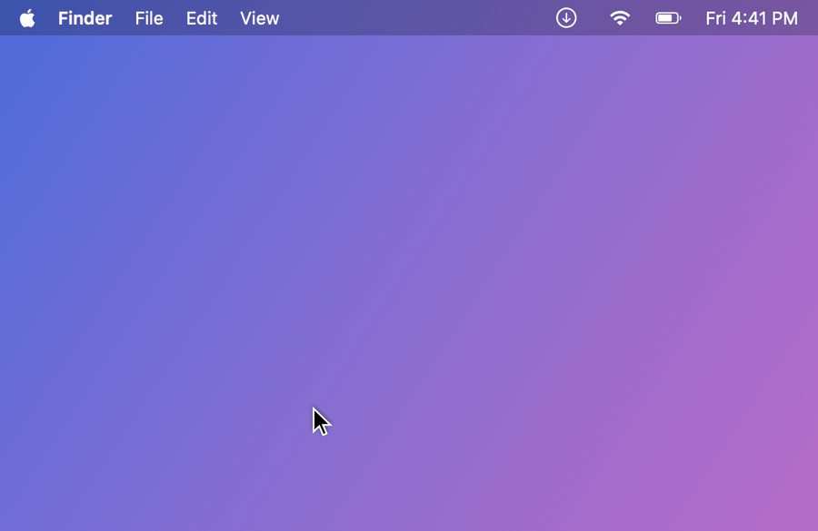

# YT Grab

**Paste a YouTube link, get an MP4 or MP3 on your Mac.**

<p align="center">
  
</p>

YT Grab is a free little app that lives in your Mac's menu bar. Paste one or more links from YouTube (or TikTok, Vimeo, SoundCloud and [many more sites](https://github.com/yt-dlp/yt-dlp/blob/master/supportedsites.md)), choose video or audio, and the files land in your **Downloads** folder.

- Runs entirely on your Mac. There's no website, no ads, no account and no upload limit.
- MP4 up to 4K, or MP3 up to 320 kb/s with cover art
- Several links at once, with progress bars
- Also works as a Terminal command (`ytgrab`) if you prefer that

## Download and install

You need a Mac running **macOS 14 (Sonoma) or newer**. Check under  → About This Mac. Installing takes about 5–10 minutes the first time, mostly waiting for downloads.

YT Grab is built on your own Mac from this code, so there's no `.dmg` to download. Instead you paste a few commands into Terminal, and they do everything for you.

### Step 1: Open Terminal

Press **⌘ Space**, type **Terminal** and press **Return**.

### Step 2: Install Homebrew (skip if you already have it)

Homebrew is a free tool that installs the video downloader YT Grab uses. Paste this into Terminal, press **Return**, and follow what it says on screen. It will ask for your Mac password; nothing appears as you type it, which is normal.

```sh
/bin/bash -c "$(curl -fsSL https://raw.githubusercontent.com/Homebrew/install/HEAD/install.sh)"
```

When it finishes, it prints a **"Next steps"** section with two or three commands. Copy and run those too, then **close Terminal and open it again**.

> Not sure if you already have it? Run `brew --version`. If it prints a version number, you're set.

### Step 3: Download and install YT Grab

Paste this and press **Return**:

```sh
git clone https://github.com/joshrkhoo/yt-grab.git ~/yt-grab && ~/yt-grab/install.sh
```

- If a window pops up asking to install **Command Line Tools**, click **Install**, wait for it to finish, then run the same command again.
- When you see **"YT Grab is running"**, you're done. A **↓** icon appears in your menu bar, near the clock.

### Step 4 (optional): Start it automatically

Open **System Settings → General → Login Items**, click **+**, and choose **YT Grab** from your **Applications** folder (the one inside your home folder).

### Updating and uninstalling

```sh
# Update to the latest version
cd ~/yt-grab && git pull && ./install.sh

# Update just the downloader (try this first if downloads stop working)
brew upgrade yt-dlp

# Uninstall
~/yt-grab/uninstall.sh && rm -rf ~/yt-grab
```

### Troubleshooting

| Problem | Fix |
| --- | --- |
| `command not found: brew` | Homebrew isn't set up yet. Redo Step 2, including the "Next steps" commands, then reopen Terminal. |
| `command not found: git` / a Command Line Tools popup | Click **Install** in the popup, wait, then rerun Step 3. |
| `destination path '…/yt-grab' already exists` | It's already downloaded. Run `~/yt-grab/install.sh` instead. |
| I can't see the ↓ icon | On MacBooks with a notch, a full menu bar can hide it. Quit a few other menu-bar apps, or check **System Settings → Menu Bar**. If you quit YT Grab, reopen it with ⌘ Space → "YT Grab". |
| A download fails | The video may be private, age-restricted or region-locked. If every download fails, run `brew upgrade yt-dlp`. |

## Using the menu-bar app

1. Click the ↓ icon in the menu bar.
2. Paste one or more links (one per line), or click **Paste**.
3. Choose **MP4** or **MP3**, and a quality or bitrate.
4. Click **Download** or press ⌘↩.

Each link shows its title and progress. ✕ cancels it, and the magnifying glass shows the finished file in Finder. Downloads keep running after you close the panel. The icon fills in while any are running, and a sound plays when each one finishes.

## Using it from Terminal

```sh
ytgrab 'https://youtu.be/dQw4w9WgXcQ'          # MP4, up to 1080p
ytgrab -a 'https://youtu.be/dQw4w9WgXcQ'       # MP3, 320 kb/s
ytgrab -q 720 'url1' 'url2' 'url3'              # several at once
ytgrab                                          # paste links, blank line to start
ytgrab -a -o ~/Music/inbox 'url'                # custom folder
ytgrab -U                                       # update yt-dlp
```

| Option | Meaning |
| --- | --- |
| `-a`, `--audio` | MP3 instead of MP4 |
| `-q N` | max video height (default 1080) |
| `-b N` | MP3 bitrate (default 320) |
| `-o DIR` | save folder (default `~/Downloads`, or `$YTGRAB_DIR`) |
| `-p` | download the whole playlist |
| `-U` | update yt-dlp |

In zsh, put quotes around links that contain `?` (`ytgrab 'https://youtube.com/watch?v=...'`), or zsh will treat them as file patterns. Running `ytgrab` with no arguments and pasting avoids this.

From Vim, put the cursor on a link and run:

```vim
:exe '!ytgrab' shellescape(expand('<cWORD>'), 1)
```

To download every link in a buffer (one per line), run `:w !ytgrab`. Add `-a` after `ytgrab` in either command for MP3.

## Notes

- MP4s prefer H.264 + AAC, so they open in QuickTime, Photos and iMovie. YouTube only serves H.264 up to 1080p, so above that you may get VP9/AV1.
- If downloads start failing, YouTube has probably changed something. Run `ytgrab -U`.
- For personal use. Downloading may break the source site's terms of service.

## How it works (for developers)

`bin/ytgrab` is a Bash wrapper that turns your options into yt-dlp flags (format sorting for H.264 MP4, or extraction to MP3 with embedded cover art). `install.sh` compiles the menu-bar app with `swiftc` and installs it into `~/Applications`. The app (`app/YTGrab.swift`, SwiftUI) bundles that same script. It runs the script once per link with `YTGRAB_MACHINE=1`, which switches the output to simple `TITLE` / `PCT` / `FILE` lines that the app parses to show progress.

To regenerate `docs/demo.gif` after changing the UI, run `./demo/make-demo.sh`. It renders the real `PanelView` off-screen through a scripted session and encodes the frames with ffmpeg.

## License

[MIT](LICENSE)
